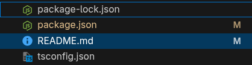
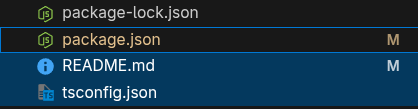
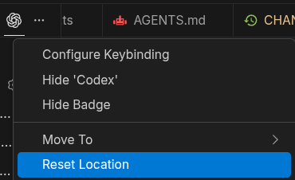

# Add to Agent Context

A VS Code extension that sends the selected content directly to agent
extensions, or simply copies a reference to that selection to the clipboard.
See [How selections are modelled](#how-selections-are-modelled) for more details
about what gets sent or copied when you have selections in an open editor or the
file explorer.

See [Demo](#demo) for a demo video.

If you compile the extension directly from main, check out [CHANGELOG.md](./CHANGELOG.md)
for unreleased changes. Those are not documented in the README.

## Installation

The extension is published on the
[Visual Studio Marketplace](https://marketplace.visualstudio.com/items?itemName=ozoniuss.add-to-agent-context).
In VS Code, open the Extensions view (`Ctrl+Shift+X`), search for
`Add to Agent Context` or `ozoniuss.add-to-agent-context`, and click
**Install**. Or install it from the command line:

```bash
code --install-extension ozoniuss.add-to-agent-context
```

You can also install it from a `.vsix` file:

1. Download the `.vsix` file from the latest
   [release](https://github.com/Ozoniuss/add-to-agent-context/releases/latest).
2. Install it from the command line:

   ```bash
   code --install-extension add-to-agent-context-<version>.vsix
   ```

   Or in VS Code, open the Command Palette (`Ctrl+Shift+P`), run
   **Extensions: Install from VSIX...** and pick the downloaded file.

## Usage

The idea is similar to Cursor's `Ctrl+L`: select some code and send it straight
to an agent's context, or copy a `path:lines` reference to paste anywhere. The
latter is particularly useful if e.g. you prefer working with agents in the
terminal.

In an editor:

- To send the selection to the agent you last sent to, press `Ctrl+'`
  (`Cmd+'` on macOS). If there is no last agent yet, it opens the picker 
  instead. (`addToAgentContext.sendSelectionToLastAgent`)
- To choose which agent to send the selection to, or to copy a `path:lines`
  reference to the clipboard, press `Ctrl+Shift+'`
  (`Cmd+Shift+'` on macOS) and pick from the list.
  (`addToAgentContext.sendSelectionToAgent`)
- To do either with the mouse, select text by dragging. A popup appears next to
  the cursor with an **Add to _agent_** button for each available agent, in the
  order they appear in `addToAgentContext.agents`, and a **Copy to clipboard**
  button.

With nothing selected in the editor, the whole file is sent or copied. See
[Selections in the open editor](#selections-in-the-open-editor) for what gets
sent when you select part of a line, several ranges, and so on.

In the explorer, with one or more files or folders selected:

- To send them to the agent you last sent to, press `Ctrl+'` (`Cmd+'` on
  macOS). If there is no last agent yet, or it can't receive files and folders,
  it opens the picker instead.
  (`addToAgentContext.sendExplorerSelectionToLastAgent`)
- To choose which agent to send them to, or to copy their paths to the
  clipboard, press `Ctrl+Shift+'` (`Cmd+Shift+'` on macOS) and pick from the
  list. Only agents that can receive files and folders are listed.
  (`addToAgentContext.sendExplorerSelectionToAgent`)

See [Selections in the file explorer](#selections-in-the-file-explorer) for
which items are used when the keyboard cursor isn't on the selected ones.

If you just want to focus on the chat of the agent you last sent to, run
**Add to Agent Context: Open Last Agent Chat in Sidebar**
(`addToAgentContext.openLastChatInSidebar`). If you haven't sent to an agent
yet, it asks which one to open. To choose the agent instead, run **Add to Agent
Context: Open Agent Chat in Sidebar...** (`addToAgentContext.openChatInSidebar`).

> The commands above were only tested when agents are opened in the sidebar.

Note that not all agents have a command that accepts a file URI. In
particular, Claude Code can only mention the file open in the active editor, so
by default it can't be sent files or folders from the explorer. I opened
[anthropics/claude-code#97535](https://github.com/anthropics/claude-code/issues/97535)
asking for a command that adds a file or folder to the chat, like Codex's
`chatgpt.addFileToThread`. In the meantime, there is an experimental workaround,
off by default: set `pasteExplorerPathsDirectly` on the agent, and the extension
pastes the paths into the agent's chat instead. For Claude Code, add this to
`settings.json`:

```json
"addToAgentContext.agents": {
    "claude": { "pasteExplorerPathsDirectly": true }
}
```

### How the last agent is detected and known limitations

The last agent is simply the last one the extension sent to in this workspace.
Any action that chose an agent, whether to send selections to it or to open its
chat, will mark it as the last agent. 

Switching to another agent's panel and working in it manually will not turn it
into the last agent. This is mainly because VS Code does not have a reliable way
to determine which panel of an extension was opened / focused last (or at least
I haven't found one).

There are ways to work around this. For example, if you always keep your agents
in the secondary side bar you can overwrite the keybindings to something like
this, which is what I use (you could use `cmd+'` instead of `ctrl+'` on macOS):

```json
    {
        "key": "ctrl+'",
        "command": "addToAgentContext.sendSelectionToLastAgent",
        "args": "claude",
        "when": "editorTextFocus && activeAuxiliary == workbench.view.extension.claude-sidebar-secondary"
    },
    {
        "key": "ctrl+'",
        "command": "addToAgentContext.sendSelectionToLastAgent",
        "args": "codex",
        "when": "editorTextFocus && activeAuxiliary == workbench.view.extension.codexSecondaryViewContainer"
    },
    {
        "key": "ctrl+'",
        "command": "addToAgentContext.sendExplorerSelectionToLastAgent",
        "args": "claude",
        "when": "filesExplorerFocus && !inputFocus && activeAuxiliary == workbench.view.extension.claude-sidebar-secondary"
    },
    {
        "key": "ctrl+'",
        "command": "addToAgentContext.sendExplorerSelectionToLastAgent",
        "args": "codex",
        "when": "filesExplorerFocus && !inputFocus && activeAuxiliary == workbench.view.extension.codexSecondaryViewContainer"
    },
    {
        "key": "ctrl+i",
        "command": "addToAgentContext.openLastChatInSidebar",
        "args": "claude",
        "when": "activeAuxiliary == workbench.view.extension.claude-sidebar-secondary"
    },
    {
        "key": "ctrl+i",
        "command": "addToAgentContext.openLastChatInSidebar",
        "args": "codex",
        "when": "activeAuxiliary == workbench.view.extension.codexSecondaryViewContainer"
    },
```

The first two entries apply in an editor, and the next two do the same in the
explorer. If the agent whose panel is open can't receive files and folders,
`Ctrl+'` in the explorer opens the picker instead. (e.g. Claude Code without `pasteExplorerPathsDirectly`)

### Default agents

| Id | Agent | Editor selection | Explorer files and folders | Open chat |
|---|---|---|---|---|
| `claude` | Claude Code | yes | no | yes |
| `codex` | Codex | yes | yes | yes |

An agent is still listed in the picker when its extension isn't installed, but
it is marked as unavailable.

### Customizing agents

Agents are configured in `settings.json` under `addToAgentContext.agents`:

```jsonc
"addToAgentContext.agents": {
    // add a new agent
    "my-agent": {
        "label": "My Agent",
        "extensionId": "someone.my-agent",
        "command": "myAgent.addSelection",
        "fileCommand": "myAgent.addFile",
        "openChatInSidebarCommand": "myAgent.openSidebar"
    },
    // change one field of a built-in agent, leaving the other ones set to default
    "claude": { "label": "Claude" },
    // remove a built-in agent
    "codex": null
}
```

| Field | Required | Meaning |
|---|---|---|
| `command` | yes | Command that adds the current editor selection to the agent's context |
| `label` | no | Name shown in the picker; defaults to the agent id |
| `fileCommand` | no | Command that adds a file or folder, called with its URI; enables the agent in the explorer picker |
| `openChatInSidebarCommand` | no | Command that opens the agent's chat in the sidebar and focuses it; used by Open Last Agent Chat in Sidebar and Open Agent Chat in Sidebar... |
| `extensionId` | no | Extension providing the agent, only used to report that it isn't installed |
| `pasteExplorerPathsDirectly` | no | Experimental, off by default. Lets the agent receive files and folders from the explorer even without a `fileCommand`, as long as it has an `openChatInSidebarCommand`. Instead of calling `fileCommand`, it copies the paths to the clipboard, opens the agent's chat and pastes them into the chat input |

### Default keybindings

The extension comes with these default keybindings.

On Windows and Linux:

```json
{
    "key": "ctrl+'",
    "command": "addToAgentContext.sendSelectionToLastAgent",
    "when": "editorTextFocus"
},
{
    "key": "ctrl+shift+'",
    "command": "addToAgentContext.sendSelectionToAgent",
    "when": "editorTextFocus"
},
{
    "key": "ctrl+'",
    "command": "addToAgentContext.sendExplorerSelectionToLastAgent",
    "when": "filesExplorerFocus && !inputFocus"
},
{
    "key": "ctrl+shift+'",
    "command": "addToAgentContext.sendExplorerSelectionToAgent",
    "when": "filesExplorerFocus && !inputFocus"
}
```

On macOS:

```json
{
    "key": "cmd+'",
    "command": "addToAgentContext.sendSelectionToLastAgent",
    "when": "editorTextFocus"
},
{
    "key": "cmd+shift+'",
    "command": "addToAgentContext.sendSelectionToAgent",
    "when": "editorTextFocus"
},
{
    "key": "cmd+'",
    "command": "addToAgentContext.sendExplorerSelectionToLastAgent",
    "when": "filesExplorerFocus && !inputFocus"
},
{
    "key": "cmd+shift+'",
    "command": "addToAgentContext.sendExplorerSelectionToAgent",
    "when": "filesExplorerFocus && !inputFocus"
}
```

### Suggested additional keybindings

```json
{
    "key": "ctrl+i",
    "command": "addToAgentContext.openLastChatInSidebar"
},
{
    "key": "ctrl+shift+i",
    "command": "addToAgentContext.openChatInSidebar"
}
```

## Demo

Unfortunately my Fedora screen recorder does not show the mouse pointer for
whatever reason. Still, I hope it's clear enough what the mouse does in each
videos to understand how the extension works.

Use with keyboard shortcuts:

https://github.com/user-attachments/assets/239e6b06-a1f4-4708-ada0-205dfe9552ba

Use with mouse:

https://github.com/user-attachments/assets/389899de-4577-46f1-9c24-c3c9f1a6df84

## How selections are modelled

The extension defines "selection" slightly differently from how VSCode defines
an editor selection. Its meaning depends on whether you want to add code snippets
from an open editor or from the file explorer.

### Selections in the open editor

In this case, a selection will be represented as a file path, followed by line
references at the end of the path.

The smallest unit of an editor selection is a line reference. Every VSCode
selection in the editor is turned into the range of lines it covers, and those
ranges are what gets copied or sent to an agent. Here are some examples:

| Selections | Result |
|---|---|
| none | `/Users/you/project/src/foo.ts` |
| a word on line 42 | `/Users/you/project/src/foo.ts:42` |
| lines 42 to 58 | `/Users/you/project/src/foo.ts:42-58` |
| lines 34-46, then 11-22 | `/Users/you/project/src/foo.ts:11-22,34-46` |
| lines 11-22 and 22-26 | `/Users/you/project/src/foo.ts:11-26` |

Note that the order in which you created selections doesn't matter. The line
number references at the end will always be written in ascending order.

There are various ways to create selections, especially with keyboard shortcuts.
For a simple way to test how this works, you can make multiple selections by
holding `alt` and making selections with the mouse.

### Selections in the file explorer

In this case, a selection will be represented as one or more absolute paths of
files or folders, without any line references.

The smallest unit of an explorer selection is a file or folder. VSCode tracks
two things in the explorer: the selected items, shown with a filled highlight,
and the focused item, shown with an outline (this typically appears when moving
with the keyboard through the explorer content). The extension follows the same
rule as VSCode's built-in **Copy Path** to decide which of them it uses. Here
are some examples:

| Explorer state | Result |
|---|---|
| `foo.ts` focused, nothing selected | `/Users/you/project/src/foo.ts` |
| `foo.ts` selected and focused | `/Users/you/project/src/foo.ts` |
| `foo.ts` selected, `bar.ts` focused | `/Users/you/project/src/bar.ts` |
| `foo.ts` and `bar.ts` selected, `baz.ts` focused | `/Users/you/project/src/foo.ts` and `/Users/you/project/src/bar.ts` |
| the `src` folder selected and focused | `/Users/you/project/src` |

The extension does not items focused when hovering with the mouse.

> Note that with a single selected item, moving the keyboard cursor away from it
makes the extension use the focused item instead. With two or more selected
items, the selection is always used, wherever the keyboard cursor is. To be
honest, I find this behavior weird. See below for the two cases:

| One item selected | Two items selected |
|---|---|
|  |  |

There are various ways to select multiple items. For a simple way to test how
this works, you can hold `ctrl` (`cmd` on macOS) and click items with the mouse,
or hold `shift` and move with the arrow keys to select a range.


## Troubleshooting and known issues

### Code context isn't sent to Claude Code or Codex (applies to secondary side bar)

There may be a bug with how the widget is dispalyed on the sidebar. Try
resetting the location of the agent's chat.



### Code context isn't sent to Codex extension

The command "Codex: Add to Codex Thread" does not seem to work for some files
(e.g. VS Code's keybindings.json file). It's not clear yet for which kind of
files it doesn't work. If you can't send snippets to Codex, also check if the
problem is with the extension's native command.

## Contributing

See [CONTRIBUTING.md](CONTRIBUTING.md) for how to run the extension locally and
how to submit changes.

## Related issues

- https://github.com/microsoft/vscode/issues/339786 and https://github.com/microsoft/vscode/issues/316820 for being able to read from file explorer via an API.
